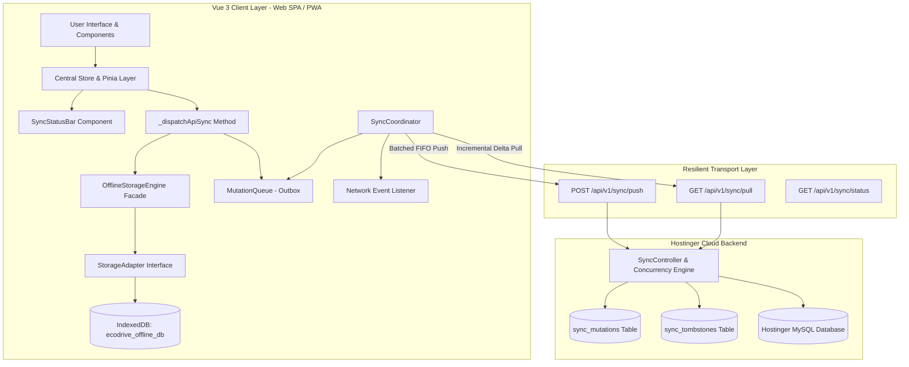
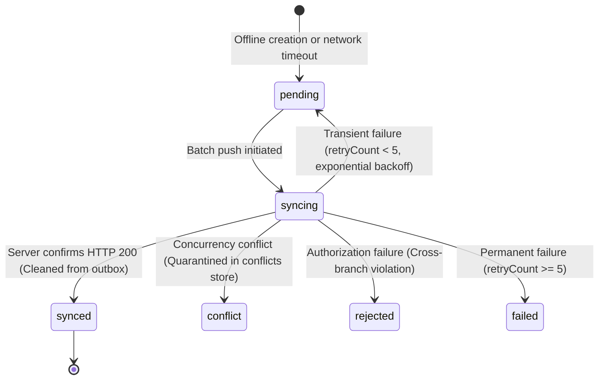

# Phase 6: Offline-First Architecture Specification

## 1. Executive Architecture Summary

AJ EcoDrive ERP is an enterprise EV Dealership Management System designed for multi-branch resilience across Pakistan (Peshawar, Islamabad, Lahore, Rawalpindi, Karachi). Because physical dealerships frequently face intermittent cellular and broadband connectivity, the system implements a production-grade **Offline-First Architecture**.

Dealership staff can continue issuing quotations, recording walk-in leads, completing deliveries, and creating sales orders without disruption while offline. When connectivity is restored, mutations synchronize automatically with strict branch scoping, idempotency, and cryptographic integrity.



---

## 2. Pluggable Storage Layer (`frontend/src/offline/storage/`)

### 2.1 The Storage Abstraction Pattern
To ensure the codebase is prepared for Phase 7 (desktop MSI and mobile APK/AAB packaging) without refactoring UI components, all storage operations use an abstract contract:

- **`StorageAdapter.js`**: Abstract base class defining transactional primitives:
  - `get(storeName, key)`
  - `set(storeName, key, value)`
  - `remove(storeName, key)`
  - `list(storeName, filterFn)`
  - `batchSet(storeName, items)`
  - `batchRemove(storeName, keys)`
  - `clear(storeName)`

- **`IndexedDBStorageAdapter.js`**: Native browser IndexedDB implementation using asynchronous IDB transactions. Features:
  - Automatic database initialization (`ecodrive_offline_db`, Version 1).
  - 5 Object Stores:
    1. `entities`: Local mirrors of business records (`customers`, `quotations`, `orders`, etc.).
    2. `outbox`: Durable queue of pending mutations waiting for network transmission.
    3. `conflicts`: Quarantined mutations that conflicted with server state.
    4. `sync_state`: System sync metadata (`last_sync_timestamp`, `branch_version`).
    5. `tombstones`: Locally deleted records tracked for server notification.
  - Transparent in-memory fallback for headless unit testing environments (Node.js/Vitest).

- **`OfflineStorageEngine.js`**: Domain-level storage facade consumed by `store.js`. Provides high-level entity lifecycle management, branch-scoped filtering, and automatic timestamp tagging.

---

## 3. Durable Outbox Command Queue (`frontend/src/offline/queue/`)

### 3.1 Immutable Mutation Command Record
Mutations are stored as declarative JSON records. They never store plain functions, non-serializable closures, or sensitive credentials:

```typescript
interface MutationCommand {
  mutationId: string;         // Unique UUID (mut_timestamp_random)
  idempotencyKey: string;     // Deduplication key (entityType:operation:entityId:timestamp)
  entityType: string;         // 'customer' | 'quotation' | 'order' | 'invoice' | 'payment' | etc.
  entityId: string;           // Entity UUID or code
  operation: 'CREATE' | 'UPDATE' | 'DELETE';
  payload: Record<string, any>; // Serialized entity state
  clientVersion: number;      // Optimistic concurrency version
  branchId: string;           // Mandatory branch context (e.g. 'BR-01')
  userId: string;             // Acting user ID
  status: 'pending' | 'syncing' | 'synced' | 'failed' | 'conflict' | 'rejected';
  retryCount: number;         // Max 5 attempts with exponential backoff
  lastError: string | null;   // Diagnostic error message
  createdAt: string;          // ISO 8601 creation timestamp
  updatedAt: string;          // ISO 8601 status transition timestamp
}
```

### 3.2 Mutation State Machine


---

## 4. Synchronization Coordinator (`SyncCoordinator.js`)

The `SyncCoordinator` orchestrates two-way synchronization:
1. **Network Presence Sensing**: Reacts to `window.online` and `window.offline` events, automatically triggering a sync pass upon reconnection.
2. **Periodic Background Cadence**: Executes non-blocking sync checks every 30 seconds when online.
3. **Batched Push**: Drains `MutationQueue.getPending()` in FIFO batches of up to 25 items to avoid HTTP request bloat.
4. **Delta Pull**: Requests server changes occurring since `last_sync_timestamp` and merges them into local storage.
5. **Reactive State**: Exposes `isOnline`, `syncStatus`, `pendingCount`, `conflictCount`, and `lastSyncTime` to UI components.

---

## 5. User-Facing UX Controls

- **`SyncStatusBar.vue`**: Embedded in `MainLayout.vue` right below the header:
  - Online/Offline Badge (Green `Wifi` / Amber `WifiOff`).
  - Active sync spinner and pending queue counter.
  - Amber conflict alert banner when unresolved conflicts exist.
  - One-click **"Sync Now"** trigger button.
- **Data-Loss Prevention (`beforeunload`)**: Emits native browser warning if the user attempts to close the tab or navigate away while unsynchronized mutations exist in the outbox.
- **Logout Guard**: Prompts user with a confirmation modal before signing out if pending outbox changes have not yet reached the server.
