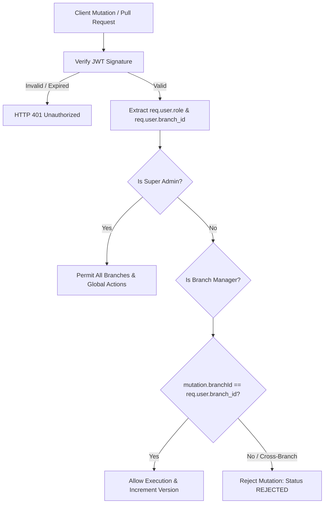

# Phase 6: Offline-First Security & Threat Model

## 1. Zero-Credential Storage Standard

The offline architecture strictly prohibits storing plaintext passwords, hashes, recovery tokens, database connection strings, or server secrets in browser storage:

| Storage Location | Allowed Data | Explicitly Prohibited Data |
| :--- | :--- | :--- |
| **`localStorage` / `sessionStorage`** | Active session metadata (JWT token, user display name, role, branch code) | Plaintext passwords, database credentials, server private keys |
| **IndexedDB (`entities`)** | Cached business records (customers, quotations, orders, inventory units) | User credentials, password hashes, payment card numbers, CVVs |
| **IndexedDB (`outbox`)** | Serialized business mutations (`payload` of created/updated records) | Plaintext passwords, authentication fallback parameters |
| **IndexedDB (`conflicts`)** | Snapshot of conflicting business entity states | Privileged administrative credentials |

---

## 2. Cryptographic Token Protection & Session Scoping

1. **Short-Lived Signed JWT**:
   - Alg: `HS256` signed using high-entropy 256-bit `JWT_SECRET`.
   - Payload carries verified user ID, role, and mandatory `branch_id`.
   - Verified on every `/api/v1/sync/*` request.
2. **Local Session Purging**:
   - When a user logs out (`store.logout()`), all IndexedDB tables (`entities`, `outbox`, `conflicts`, `sync_state`, `tombstones`) are completely cleared via `offlineStorage.clearAllData()`.
   - Prevents a subsequent user on a shared dealership workstation from inspecting previous branch records or outbox state.

---

## 3. Multi-Tenant Branch Scoping & Authorization Gate

Every sync operation is guarded by multi-tenant access checks:

---

## 4. Concurrency & Replay Attack Defense

1. **Idempotency Fingerprinting**:
   - Every mutation is assigned a deterministic `idempotencyKey` formatted as `${entityType}:${operation}:${entityId}:${mutationId}`.
   - The backend checks `sync_mutations` in an atomic query. If the key already exists, the server returns the cached status without re-executing business logic.
   - Prevents network replay attacks, duplicate sales orders, duplicate payments, or repeated stock allocation.
2. **Optimistic Version Lock**:
   - Financial transactions (`payments`, `invoices`) and physical serialized stock (`serialized_units`) maintain numeric version counters.
   - If an offline client attempts an update against a record whose server version has advanced, the mutation is rejected from automatic overwrite and quarantined with `REQUIRE_MANAGER_APPROVAL`.
